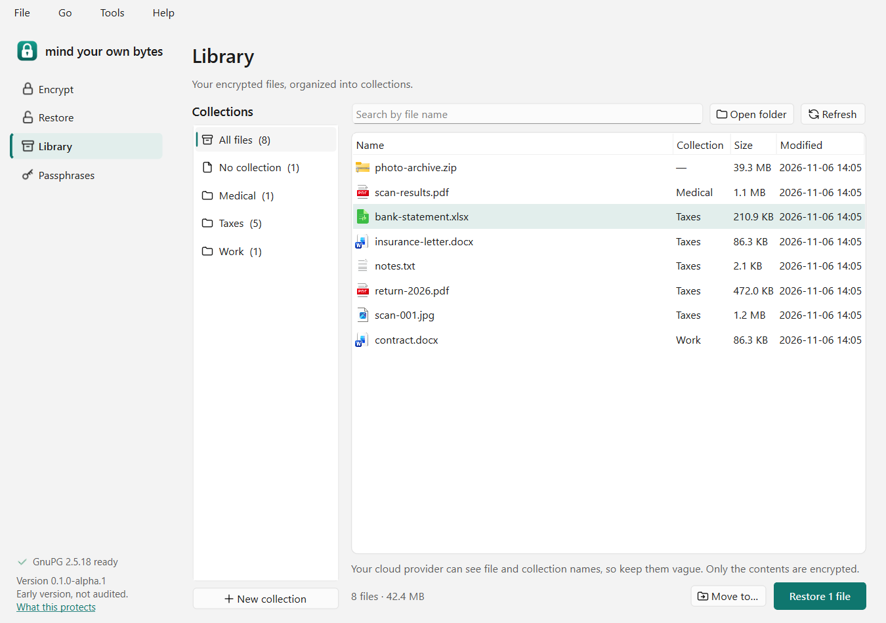
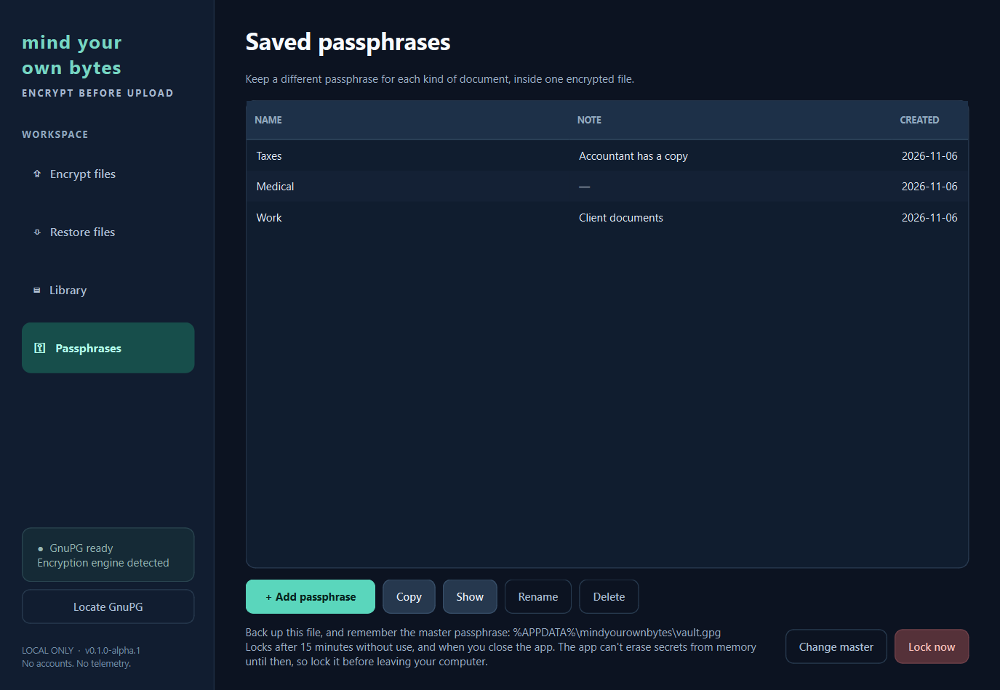

# mindyourownbytes

**Your files. Your keys. None of their business.**

Encrypt your files on your own computer, then put them on any cloud you like. No
account, no API keys, no new file format: just standard OpenPGP files that open with
plain GnuPG, with or without this app.

**[Download for Windows](https://github.com/N-Bermparis/mindyourownbytes/releases)** · [Linux and macOS](#run-from-source)

[](https://github.com/N-Bermparis/mindyourownbytes/actions/workflows/ci.yml)
[](LICENSE)


> [!CAUTION]
> **Alpha software, not independently audited.** Security review is exactly what this
> release is asking for. Please test with non-sensitive files first, keep other verified
> backups, and read [what it does and doesn't protect](#what-it-protects-and-what-it-doesnt).

## Why this exists

Mainstream cloud storage can read what you upload, because the provider holds the keys.
This isn't a secret, and it's right there in the terms:

- [Dropbox's terms](https://www.dropbox.com/terms) say it accesses and scans stored files
  to provide features such as search and previews.
- [Google's terms](https://policies.google.com/terms) describe automated systems analyzing
  content, including while it is stored.
- [Microsoft's Services Agreement](https://www.microsoft.com/en-us/servicesagreement) says
  automated systems and people may review content for things like spam and fraud.
- [Apple holds the keys to iCloud Drive](https://support.apple.com/en-us/102651) unless you
  turn on Advanced Data Protection.

These are mostly about features, abuse, and legal duties rather than someone reading your
tax return for fun. But whatever a company *can* read can also be breached, subpoenaed,
misused by an insider, or fed into next year's product.

The fix is old and simple: encrypt before you upload, so the provider stores only bytes it
can't read. This app makes that a drag and drop.

## What it does

- **Drag in files or folders** and get encrypted `.gpg` copies, with folder structure kept.
  Your originals are never changed, and existing files are never overwritten.
- **One passphrase for a whole batch**, typed once.
- **Choose the algorithm** for passphrase encryption: AES-256 (recommended), Twofish, or Camellia-256.
- **Save different passphrases** for different kinds of documents, in an optional vault
  encrypted under one master passphrase. It can also generate strong ones.
- **Organize into collections** such as Taxes or Medical, then browse, search, and move files
  in the Library. Collections are plain folders, so they work in Explorer and on any cloud too.
- **Or use OpenPGP keys** you already manage in Kleopatra, with each key's type shown, including
  post-quantum Kyber keys with GnuPG 2.5 or later.
- **Restore safely.** Forged, tampered, and truncated files are rejected, with nothing written.
- **Works with any storage**, because it never talks to any: Google Drive, OneDrive, Dropbox,
  iCloud, a NAS, or a USB stick. You upload the files yourself.
- **Clear, guided steps** in plain language, using your system's own controls and its light or
  dark mode. Failed files can be retried with one click.

| Library | Saved passphrases |
| --- | --- |
|  |  |

No telemetry, no accounts, and no network calls. The Windows download doesn't even contain
the network code from its libraries. All cryptography is done by [GnuPG](https://gnupg.org/):
this project does not implement any of its own.

## Getting started

**On Windows 10 or 11:**

1. [Download the installer](https://github.com/N-Bermparis/mindyourownbytes/releases), the file ending in `-setup.exe`.
2. Run it and click **Install**. It needs no administrator rights, and there's nothing else to
   install: [GnuPG](https://gnupg.org/) is included.

To update, run a newer installer over the old one. To remove the app, use Settings > Apps. Neither
touches your encrypted files, keys, or saved passphrases. Prefer not to install anything? The
`-portable.zip` is the same app: unzip it and open `mindyourownbytes.exe`.

If you already have [Gpg4win](https://gpg4win.org/), the app uses that instead of its own copy, so
your keys and Kleopatra keep working as they are. Keys are optional: you only need Gpg4win to create
one, and most people can use a passphrase.

### Windows will warn you

The downloads aren't code-signed yet, so Windows doesn't recognize who published them.

- **"Windows protected your PC":** after [checking your download](#check-your-download), click
  **More info**, then **Run anyway**.
- **Smart App Control** blocks unsigned apps with no way to continue. If it's on, wait for signed
  builds, or [run from source](#run-from-source).

### Check your download

Each [release](https://github.com/N-Bermparis/mindyourownbytes/releases) lists the SHA-256 checksum of every file. In PowerShell, run this on the
file you downloaded, and compare the result:

```powershell
Get-FileHash .\mindyourownbytes-*-setup.exe
```

A match shows that you have the file published there, which is what matters if it reached you some
other way or was damaged on the way. It can't help if the GitHub account itself were compromised:
the [threat model](docs/THREAT_MODEL.md#the-windows-download) explains what you're trusting.

### Run from source

For Linux and macOS, or if you'd rather not run a download. You need
[Python 3.12+](https://www.python.org/downloads/) and GnuPG.

**Windows**

1. Install [Gpg4win](https://gpg4win.org/download.html).
2. [Download the code](https://github.com/N-Bermparis/mindyourownbytes/archive/refs/heads/main.zip) and unzip it.
3. Run `setup_windows.bat` once. It needs internet access to install the interface library, with
   every package checked against a hash in `requirements.txt`.
4. Run `start_windows.bat`.

**Linux and macOS (experimental)**

```bash
git clone https://github.com/N-Bermparis/mindyourownbytes.git
cd mindyourownbytes
python3 -m venv .venv && source .venv/bin/activate
pip install --require-hashes -r requirements.txt
python -m mindyourownbytes
```

CI runs the tests on Linux, but the app is mainly developed and used on Windows, and it hasn't
been tested on macOS. Reports are very welcome.

## How to use it

**Encrypt**

1. Drop files or folders onto the window.
2. Choose how to protect them. *Passphrase* is the simplest. You can also pick an algorithm, but
   AES-256 suits nearly everyone.
3. Optionally type a collection name, such as `Taxes`.
4. Click **Encrypt**. When it's done, click **Open folder** and upload what's there. By default
   that's `%USERPROFILE%\mindyourownbytes\Encrypted Exports`.

**Restore**

1. Download your `.gpg` files and drop them on the **Restore** screen, or select them in the
   **Library**.
2. The app selects how to unlock them based on how they were encrypted, and you can change it.
3. Choose a folder that no cloud service syncs, then click **Restore**.

### Which method should I choose?

| Method | Good for | Trade-off |
| --- | --- | --- |
| **Passphrase** | Most people | The passphrase passes through this app |
| **Saved passphrase** | Different secrets for different documents | One master passphrase guards them all |
| **OpenPGP key** | Existing Kleopatra users | You must back up your private key, and forged files aren't detected ([why](docs/THREAT_MODEL.md#tampering)) |

Would you rather this app never saw your passphrase? Turn on **Tools > Let GnuPG ask for each
passphrase**. You'll then be asked once for every file, so it's slower for folders.

### Which algorithm should I choose?

Keep **AES-256** unless you have a reason not to. All three are strong, so this is about preference
and compatibility rather than extra protection, and none of them can rescue a weak passphrase.

| Algorithm | GnuPG | Other OpenPGP tools |
| --- | --- | --- |
| **AES-256** (recommended) | ✅ Opens it | Almost all, because the OpenPGP standard asks every tool to support it |
| **Twofish** | ✅ Opens it | Not all, because it's optional in the standard. OpenPGP.js opens it |
| **Camellia-256** | ✅ Opens it | Not all, because it's optional in the standard. OpenPGP.js can't open it |

Restoring never asks, because each file records its own algorithm. Older ciphers such as CAST5 and
3DES aren't offered, and the vault always uses AES-256.

With an **OpenPGP key**, the key decides, so the key list shows each key's type. Classical keys such as
RSA and Curve25519 aren't safe against a future quantum computer, while Kyber keys are designed to be
([more on this](docs/THREAT_MODEL.md#other-limits)).

## No lock-in

Your data never depends on this project still existing. With this app gone, plain GnuPG
still works:

```bash
gpg --output report.pdf --decrypt report.pdf.gpg
```

The vault is the same kind of file. This prints every saved passphrase:

```bash
gpg --decrypt "%APPDATA%\mindyourownbytes\vault.gpg"
```

During review, files from both encryption modes were also decrypted byte for byte by
[OpenPGP.js](https://openpgpjs.org/), an entirely separate implementation, with one exception:
[it can't open Camellia-256](#which-algorithm-should-i-choose). For the details on file formats, see
the [threat model](docs/THREAT_MODEL.md#how-the-design-defends-you).

**Back up your passphrases, master passphrase, and private keys somewhere other than the
cloud you're protecting against.** If you lose them, nobody can recover your files. That
is the point, and also the risk.

## What it protects and what it doesn't

**Protected:** the contents of your files, from your cloud provider and from anyone who gets
a copy of your cloud data, as long as your passphrase is strong.

**Not protected:**

- ⚠️ **File and folder names and approximate sizes are visible.** `divorce-settlement.pdf.gpg`
  says plenty by itself. Keep names vague, or use one of the tools below until
  [this gets fixed](docs/ROADMAP.md).
- **Files already in a synced folder.** If your originals live in OneDrive or Dropbox, the provider
  likely has them already. The app warns when it recognizes such a folder.
- **Rollback and swaps.** A provider could serve an old version of a file, or swap two files that
  share a passphrase. Neither is detected.
- **A compromised computer.** Malware can read whatever you can.
- **A weak passphrase.** Use five or more random words, or the Generate button.

The [threat model](docs/THREAT_MODEL.md) has the full picture, including the vault's trade-offs.

## How it compares

Many good tools already exist, so here's an honest comparison.

| | mindyourownbytes | [Cryptomator](https://cryptomator.org/) | [rclone crypt](https://rclone.org/crypt/) | [Kleopatra](https://www.openpgp.org/software/kleopatra/) |
| --- | --- | --- | --- | --- |
| **Interface** | Desktop app | Desktop and mobile apps | Command line | Desktop app |
| **File format** | Standard OpenPGP | Its own documented format | Its own documented format | Standard OpenPGP |
| **Open without the app** | GnuPG or other OpenPGP tools | A compatible tool | rclone or a compatible tool | GnuPG or other OpenPGP tools |
| **Hides file names** | ❌ Not yet | ✅ | ✅ On by default | ❌ |
| **Saved passphrases by purpose** | ✅ | One per vault | Per remote | ❌ |
| **Independent audit** | ❌ Not yet | ✅ [2017](https://community.cryptomator.org/t/has-there-been-a-security-review-audit-of-cryptomator/44) | | |

**Choose this if** you want plain, durable `.gpg` files you can open with anything, without
mounting a vault. **Choose [Cryptomator](https://cryptomator.org/) if** you need hidden file names
or an audited tool today, as it's excellent at both. **Choose rclone crypt if** you're comfortable
on the command line and want automated sync.

## Get involved

This project needs people who care about privacy, and not all of them write code.

- **Review the security.** Try to break it. The [threat model](docs/THREAT_MODEL.md) is a good
  starting point, and vulnerabilities go through [private reporting](SECURITY.md).
- **Test it** on your setup and say what confused you.
- **Pick up an issue.** Start with [`good first issue`](https://github.com/N-Bermparis/mindyourownbytes/labels/good%20first%20issue),
  or take on the big one: [hiding file names](docs/ROADMAP.md).
- **Help with** translations, accessibility, and packaging.

See [CONTRIBUTING.md](CONTRIBUTING.md) for setup, and the [roadmap](docs/ROADMAP.md) for where this
is going. Please follow the [Code of Conduct](CODE_OF_CONDUCT.md).

## License

[GNU General Public License v3.0 or later](LICENSE). Anyone who distributes a modified version
must publish its source, so nobody can ship a closed copy of a privacy tool that can't be audited.

Maintained by [Nikolaos Bermparis](https://github.com/N-Bermparis). Not affiliated with any cloud
provider, or with the GnuPG project.
