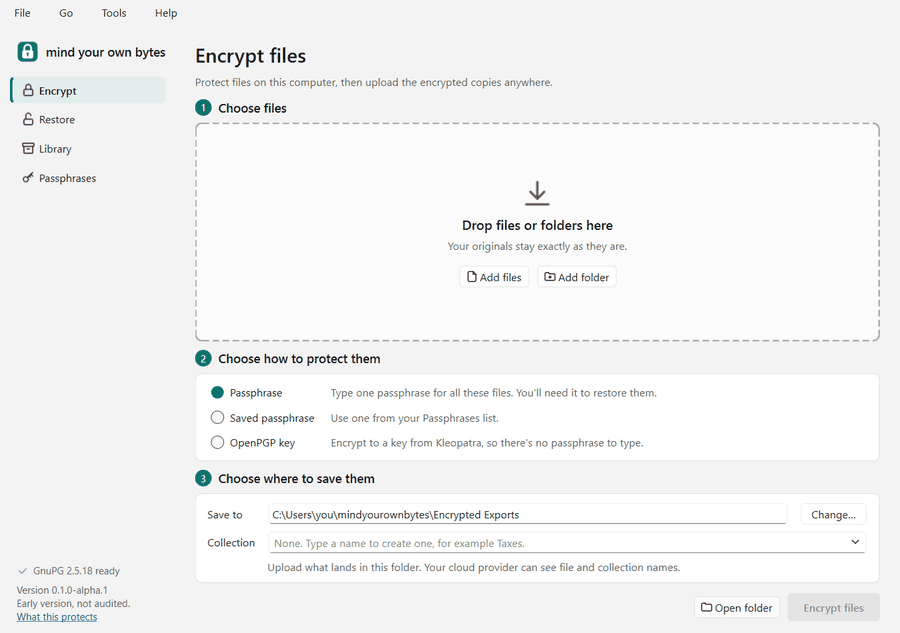

# mindyourownbytes

**Your files. Your keys. None of their business.**

Encrypt your files on your own computer, then put them on any cloud you like. No
account, no API keys, no new file format: just standard OpenPGP files that open with
plain GnuPG, with or without this app.

**[Download for Windows, macOS, and Linux](https://github.com/N-Bermparis/mindyourownbytes/releases)** · [or run it from source](#run-from-source)

[](https://github.com/N-Bermparis/mindyourownbytes/actions/workflows/ci.yml)
[](LICENSE)




> [!CAUTION]
> **Alpha software, not independently audited.** Security review is exactly what this
> release is asking for. Please test with non-sensitive files first, keep other verified
> backups, and read [what it does and doesn't protect](#what-it-protects-and-what-it-doesnt).

## Why this exists

Mainstream cloud storage can read what you upload, because the provider holds the keys.
This isn't a secret, and it's right there in the terms:

- [Dropbox's terms](https://www.dropbox.com/terms) say it accesses and scans stored files
  to provide features such as search and previews.
- [Google's terms](https://policies.google.com/terms) describe automated systems analyzing
  content, including while it is stored.
- [Microsoft's Services Agreement](https://www.microsoft.com/en-us/servicesagreement) says
  automated systems and people may review content for things like spam and fraud.
- [Apple holds the keys to iCloud Drive](https://support.apple.com/en-us/102651) unless you
  turn on Advanced Data Protection.

These are mostly about features, abuse, and legal duties rather than someone reading your
tax return for fun. But whatever a company *can* read can also be breached, subpoenaed,
misused by an insider, or fed into next year's product.

The fix is old and simple: encrypt before you upload, so the provider stores only bytes it
can't read. This app makes that a drag and drop.

## What it does

- **Drag in files or folders** and get encrypted `.gpg` copies, with folder structure kept.
  Your originals are never changed, and nothing already there is ever replaced, not even an empty
  folder: a finished file or folder gets its name in one step, and only if the name is free.
- **Or right-click them in File Explorer** and choose **Encrypt with mindyourownbytes**.
- **Or pack them into one archive** that hides the names of the files and folders inside. Your
  provider sees one `.zip.gpg` file, and restoring it gives you the folder back.
- **One passphrase for a whole batch**, typed once.
- **Files encrypted with a passphrase are checked before they're called done.** When the app has the
  passphrase, it decrypts each new file again and compares it with your original. A copy that doesn't
  match is thrown away, and you're told why. Files for an OpenPGP key, or whose passphrase GnuPG asked
  for itself, can't be checked this way, and say **Encrypted, not checked**.
- **Choose the algorithm** for passphrase encryption: AES-256 (recommended), Twofish, or Camellia-256.
- **Save different passphrases** for different kinds of documents, in an optional vault
  encrypted under one master passphrase.
- **Let your computer pick a passphrase**, wherever you choose one: seven random words that are
  easy to type, or 30 random letters and digits. The app says exactly how strong it is. A new
  passphrase you make up is checked on your computer, and one that's common or easily guessed, such
  as `Password123!` or `qwertyuiop`, isn't accepted for new files or a new vault.
- **Organize into collections** such as Taxes or Medical, then browse, search, and move files
  in the Library. Collections are plain folders, so they work in Explorer and on any cloud too.
- **Or use OpenPGP keys** you already manage in Kleopatra, with each key's type shown, including
  post-quantum Kyber keys with GnuPG 2.5 or later. **Tools > Post-quantum keys** checks what your
  GnuPG can do, explains who can open such files, and can create one or upgrade a key of yours.
- **Sign what you encrypt to a key**, so that restoring it can show who made it. Anyone with a public
  key can encrypt to it, so without a signature nothing does. Each restored file says whether it was
  signed, and by which key, with its fingerprint.
- **Restore safely.** Forged, tampered, and truncated files are rejected, and so is a file with an
  invalid signature, with nothing written. Each download is also compared with a checksum saved on
  your computer when it was made, so an older or swapped copy is flagged. Checksums can be saved as a
  list and checked on another computer.
- **Works with any storage**, because it never talks to any: Google Drive, OneDrive, Dropbox,
  iCloud, a NAS, or a USB stick. You upload the files yourself.
- **Clear, guided steps** in plain language, using your system's own controls and its light or
  dark mode. Failed files can be retried with one click.
- **Simple unless you ask for more.** New installations offer a passphrase or a saved one, with safe
  settings. **Tools > Show advanced options** adds OpenPGP keys, a choice of algorithm, and more.

| Library | Saved passphrases |
| --- | --- |
|  |  |

No telemetry, no accounts, and no network calls. The downloads don't even contain Qt's network
library or Python's socket and SSL modules. All cryptography is done by [GnuPG](https://gnupg.org/):
this project does not implement any of its own.

## Getting started

**On Windows 10 or 11:**

1. [Download the installer](https://github.com/N-Bermparis/mindyourownbytes/releases), the file ending in `-setup.exe`.
2. Run it and click **Install**. It needs no administrator rights, and there's nothing else to
   install: [GnuPG](https://gnupg.org/) is included. It also adds **Encrypt with mindyourownbytes**
   to File Explorer's right-click menu, unless you untick that.

To update, run a newer installer over the old one. To remove the app, use Settings > Apps. Neither
touches your encrypted files, keys, or saved passphrases. Prefer not to install anything? The
`-portable.zip` is the same app: unzip it and open `mindyourownbytes.exe`. It doesn't add the right-click
entry, because it changes nothing on your computer.

If you already have [Gpg4win](https://gpg4win.org/), the app uses that instead of its own copy, so
your keys and Kleopatra keep working as they are. Keys are optional: you only need Gpg4win to create
one, and most people can use a passphrase.

**On a Mac with Apple silicon:**

1. [Download the disk image](https://github.com/N-Bermparis/mindyourownbytes/releases), the file ending in
   `-macos-arm64.dmg`.
2. Open it, and drag **mindyourownbytes** into **Applications**.
3. Install GnuPG, which does all the encryption, from [GPG Suite](https://gpgtools.org/), or with
   [Homebrew](https://brew.sh/): `brew install gnupg`. The app tells you if it can't find it.

The app isn't signed by Apple yet, so the first time, macOS won't open it. After
[checking your download](#check-your-download), open **System Settings > Privacy & Security** and click
**Open Anyway** beside its name. An Intel Mac can [run it from source](#run-from-source).

**On Linux, with a 64-bit Intel or AMD processor:**

1. [Download the archive](https://github.com/N-Bermparis/mindyourownbytes/releases), the file ending in
   `-linux-x86_64.tar.gz`.
2. Unpack it anywhere, and run `mindyourownbytes` in the folder it makes. `./add-to-menu.sh`, in the
   same folder, adds it to your applications menu, for your account only.
3. Most Linux systems already have GnuPG. If yours doesn't, install it with your package manager,
   such as `sudo apt install gnupg`.

Unlike the Windows download, these two don't include GnuPG. They use the copy that comes from your
system's usual source, which your keys already work with.

### Windows will warn you

The downloads aren't code-signed yet, so Windows doesn't recognize who published them.

- **"Windows protected your PC":** after [checking your download](#check-your-download), click
  **More info**, then **Run anyway**.
- **Smart App Control** blocks unsigned apps with no way to continue. If it's on, wait for signed
  builds, or [run from source](#run-from-source).

### Check your download

Each [release](https://github.com/N-Bermparis/mindyourownbytes/releases) lists the SHA-256 checksum of every file. Run the line for your
system on the file you downloaded, and compare the result:

```powershell
Get-FileHash .\mindyourownbytes-*-setup.exe          # Windows, in PowerShell
```

```bash
shasum -a 256 mindyourownbytes-*-macos-arm64.dmg     # macOS, in Terminal
sha256sum mindyourownbytes-*-linux-x86_64.tar.gz     # Linux
```

A match shows that you have the file published there, which is what matters if it reached you some
other way or was damaged on the way. It can't help if the GitHub account itself were compromised:
the [threat model](docs/THREAT_MODEL.md#the-downloads) explains what you're trusting.

Two more checks become possible as the project gets the keys for them. Neither is in place yet, and
this section will say when one is:

- **A signed list of checksums.** A release may include `SHA256SUMS.txt.asc`, an OpenPGP signature of
  the checksum list made with the project's release key. Check it with
  `gpg --verify SHA256SUMS.txt.asc SHA256SUMS.txt`, and compare the fingerprint GnuPG names with the
  one published in [SECURITY.md](SECURITY.md#verifying-a-download), not with one found next to the
  download.
- **Code signatures.** Signed Windows downloads show a verified publisher, and signed and notarized
  macOS ones open without Gatekeeper's warning. Until then, Windows and macOS warn about them, as
  described above. Never take a download that claims to be signed on its word: in PowerShell,
  `Get-AuthenticodeSignature .\FILE` must say `Valid`, and on a Mac,
  `spctl --assess --type open --context context:primary-signature -v FILE` must say `accepted`.

Once the repository is public, each file also gets a
[build attestation](https://docs.github.com/actions/security-for-github-actions/using-artifact-attestations)
tying it to the workflow run and commit that built it: `gh attestation verify FILE --repo N-Bermparis/mindyourownbytes`.

### Run from source

For an Intel Mac, a Linux computer with another kind of processor, or if you'd rather not run a
download. You need
[Python 3.12+](https://www.python.org/downloads/) and GnuPG.

**Windows**

1. Install [Gpg4win](https://gpg4win.org/download.html).
2. [Download the code](https://github.com/N-Bermparis/mindyourownbytes/archive/refs/heads/main.zip) and unzip it.
3. Run `setup_windows.bat` once. It needs internet access to install the interface library, with
   every package checked against a hash in `requirements.txt`.
4. Run `start_windows.bat`.

**Linux and macOS**

```bash
git clone https://github.com/N-Bermparis/mindyourownbytes.git
cd mindyourownbytes
python3 -m venv .venv && source .venv/bin/activate
pip install --require-hashes -r requirements.txt
python -m mindyourownbytes
```

CI runs the tests on Linux, and tests each download by running it, on Windows, Linux, and macOS.
The app is mainly developed and used on Windows, so reports from Linux and Mac users are very welcome.

## How to use it

**Encrypt**

1. Drop files or folders onto the window. Or, in File Explorer, right-click them and choose
   **Encrypt with mindyourownbytes**. On Windows 11, that's under **Show more options**. They're
   added to the list, and nothing is encrypted until you click **Encrypt**. For a lot of files at
   once, right-click their folder instead, because Windows can leave the entry out for a large selection.
2. Choose how to protect them. *Passphrase* is the simplest. For OpenPGP keys or a choice of
   algorithm, click **More options**, or turn on **Tools > Show advanced options**. AES-256, which
   simple mode always uses, suits nearly everyone.
3. Optionally type a collection name, such as `Taxes`. To hide the names of what you're encrypting,
   choose **One archive** under **Save as**, and give it a vague name.
4. Click **Encrypt**. With a passphrase, each file is encrypted, then decrypted again and compared
   with your original, and its row then says **Encrypted and checked**. With a key, each row says
   **Encrypted, not checked**, or **Signed and encrypted, not checked** if you chose to sign.
5. When it's done, click **Open folder** and upload what's there. By default that's
   `%USERPROFILE%\mindyourownbytes\Encrypted Exports`.

**Restore**

1. Download your `.gpg` files and drop them on the **Restore** screen, or a whole folder of them. In
   the **Library**, select files, or select none to restore everything shown, such as a collection.
   Folders are kept either way.
2. The app selects how to unlock them based on how they were encrypted, and you can change it. A
   batch can mix both kinds: type the passphrase once, and files for your key are opened with it.
3. Choose a folder that no cloud service syncs, then click **Restore**. Each row says whether the
   download **matches your record**, or warns if it's an older or swapped copy. If one isn't the
   copy you made, the app asks before decrypting it, and leaves it out unless you say otherwise.
   A file for a key also says whether it was **signed**, and by whom: see
   [Who made a file](#who-made-a-file).
4. If the app is ever stopped partway through a restore, by a crash or a power cut, it can leave
   readable data in a hidden `.myob-….partial` folder beside the destination. The next time it starts,
   it lists exactly where, and offers to delete what it can prove it made. **Tools > Clean up after an
   interrupted restore** does the same at any time.

On another computer, the app has no record of what you made. In the Library on the computer that
made them, **Save checksums** writes a list, and on the other computer **Tools > Import checksums**
reads it. Keep that list somewhere your provider can't change, such as a USB stick.

### Which method should I choose?

| Method | Good for | Trade-off |
| --- | --- | --- |
| **Passphrase** | Most people | The passphrase passes through this app |
| **Saved passphrase** | Different secrets for different documents | One master passphrase guards them all |
| **OpenPGP key** | Existing Kleopatra users | You must back up your private key, and only signed files show who made them ([why](docs/THREAT_MODEL.md#tampering)) |

**Simple mode**, which new installations start in, offers the first two. Anyone who already has a
key of their own, or has changed an advanced setting, starts in advanced mode, so nothing they use
disappears.

Would you rather this app never saw your passphrase? In advanced mode, turn on **Tools > Let GnuPG ask for each
passphrase**. You'll then be asked once for every file, so it's slower for folders, and the app
can't check the new files.

### What "Encrypted and checked" means

The new file decrypted back to exactly your original, on this computer, a moment ago. That's worth
knowing before you delete an original, but it has limits:

- **It can't see your upload.** Nothing here checks that a file reached your cloud intact.
- **Files for an OpenPGP key aren't checked**, and neither are files that GnuPG asked about itself.
  Checking them would mean asking you again, so they're marked **Encrypted, not checked**.
- **A file that fails is not kept.** Its row says why, and **Try these again** runs it again. If the
  original changed while it was being encrypted, the app says that instead.

The check is on by default, and it takes time. On one test computer, a 256 MB file took 9 seconds
in place of 6, and 200 small files took 56 seconds in place of 34. You can turn it off under
**Tools > Check each file after encrypting it**.
The [threat model](docs/THREAT_MODEL.md#how-the-design-defends-you) has the details.

### Who made a file

Five different things can be true of a file, and the app keeps them apart:

1. **It was encrypted.** Only the passphrase or the private key opens it.
2. **It decrypted.** It hasn't been damaged or altered since it was encrypted. With a passphrase, it
   was also made by someone who knew the passphrase. With a key, it could have been made by **anyone**
   who has the public key, which is meant to be public.
3. **It matches your record.** It's the very file this computer made, by its checksum.
4. **Its signature is valid.** It hasn't changed since the holder of a particular private key signed it.
5. **That key is someone you trust.** The key is yours, or you checked its fingerprint with its owner and
   certified it in Kleopatra. A name or email address in a key proves nothing by itself: anyone can make
   a key with any name.

When you encrypt to a key in advanced mode, **Also sign them with** adds a signature made with your own
key. It's ticked whenever you have a key that can sign, unless you untick it. GnuPG asks for your key's
passphrase itself, so the app never sees it, and the files stay standard OpenPGP that plain
`gpg --decrypt` opens and checks. A restored file for a key then says **signed by** the key's name, if
it's yours or one you've certified, and its tooltip shows the full fingerprint. A file whose signature
is invalid, or can't be checked, is never restored.

A file for your key that no key you've verified signed isn't restored without asking, because anyone
could have made it. That includes files you encrypted to a key before signing existed, or without it.
It's decrypted, deleted again, and listed as **not restored yet**. **Restore anyway…** shows what each
one showed, such as **not signed**, or **signed with a key you haven't verified** and that key's
fingerprint, and restores it only if it still shows exactly that when decrypted again. Under **Tools >
Files for your key with no verified signature**, you can choose **Never restore them** instead, or, in
advanced mode, **Restore them, and say so**. Files opened with a passphrase are never affected.

### Which algorithm should I choose?

Keep **AES-256** unless you have a reason not to. All three are strong, so this is about preference
and compatibility rather than extra protection, and none of them can rescue a weak passphrase.

| Algorithm | GnuPG | Other OpenPGP tools |
| --- | --- | --- |
| **AES-256** (recommended) | ✅ Opens it | Almost all, because the OpenPGP standard asks every tool to support it |
| **Twofish** | ✅ Opens it | Not all, because it's optional in the standard. OpenPGP.js opens it |
| **Camellia-256** | ✅ Opens it | Not all, because it's optional in the standard. OpenPGP.js can't open it |

Restoring never asks, because each file records its own algorithm. Older ciphers such as CAST5 and
3DES aren't offered, and the vault always uses AES-256.

With an **OpenPGP key**, the key decides, so the key list shows each key's type. Classical keys such as
RSA and Curve25519 aren't safe against a future quantum computer, while Kyber keys are designed to be
([more on this](docs/THREAT_MODEL.md#other-limits)). **Tools > Post-quantum keys** walks you through it.
Before using one, know that files encrypted to it only open with GnuPG 2.5 or later.

## No lock-in

Your data never depends on this project still existing. With this app gone, plain GnuPG
still works:

```bash
gpg --output report.pdf --decrypt report.pdf.gpg
```

An archive decrypts to an ordinary zip, which File Explorer, macOS, and Linux open without help:

```bash
gpg --output Paperwork.zip --decrypt Paperwork.zip.gpg
```

On Windows, open it in File Explorer: Windows' own `tar` command can't read names that aren't
plain English letters.

The vault is the same kind of file. This prints every saved passphrase:

```bash
gpg --decrypt "%APPDATA%\mindyourownbytes\vault.gpg"
```

During review, files from both encryption modes were also decrypted byte for byte by
[OpenPGP.js](https://openpgpjs.org/), an entirely separate implementation, with one exception:
[it can't open Camellia-256](#which-algorithm-should-i-choose). For the details on file formats, see
the [threat model](docs/THREAT_MODEL.md#how-the-design-defends-you).

**Back up your passphrases, master passphrase, and private keys somewhere other than the
cloud you're protecting against.** If you lose them, nobody can recover your files. That
is the point, and also the risk.

**Help > Restore on another computer** walks through doing it on Windows, macOS, or Linux, with or
without this app, including the exact commands. **Save these steps** writes them to a text file to
keep beside your backups. It holds no secrets.

## What it protects and what it doesn't

**Protected:** the contents of your files, from your cloud provider and from anyone who gets
a copy of your cloud data, as long as your passphrase is strong.

**Not protected:**

- ⚠️ **File and folder names and approximate sizes are visible**, unless you use one archive.
  `divorce-settlement.pdf.gpg` says plenty by itself. An archive hides the names inside, but its
  own name and total size still show, and changing one file means uploading the whole archive again.
- **Files already in a synced folder.** If your originals live in OneDrive or Dropbox, the provider
  likely has them already. The app warns when it recognizes such a folder.
- **Rollback and swaps, without a record.** A provider could serve an old version of a file, or swap
  two files that share a passphrase. The app flags both when restoring files it made on this
  computer, or whose checksums you imported, but can't tell for any other file.
- **Who made a file for a key, unless it's signed.** Anyone with your public key can make one that
  decrypts perfectly. [Signing](#who-made-a-file) closes that gap for files made from now on.
- **A compromised computer.** Malware can read whatever you can.
- **A weak passphrase.** Use five or more random words, or let the app generate one. The app refuses
  new passphrases that are common or follow an obvious pattern, but no check can measure a passphrase
  you make up, so it only states the strength of ones it generates.
- **Secure deletion.** Deleting a file, including the app's temporary ones, doesn't erase it from an
  SSD, a backup, or a sync client's history.

To see it with your own files, open **Help > What your provider sees**, or the link on the Encrypt
screen or in the Library. It shows the same files as you see them and as your provider does.

The [threat model](docs/THREAT_MODEL.md) has the full picture, including the vault's trade-offs.

## How it compares

Many good tools already exist, so here's an honest comparison.

| | mindyourownbytes | [Cryptomator](https://cryptomator.org/) | [rclone crypt](https://rclone.org/crypt/) | [Kleopatra](https://www.openpgp.org/software/kleopatra/) |
| --- | --- | --- | --- | --- |
| **Interface** | Desktop app | Desktop and mobile apps | Command line | Desktop app |
| **File format** | Standard OpenPGP | Its own documented format | Its own documented format | Standard OpenPGP |
| **Open without the app** | GnuPG or other OpenPGP tools | A compatible tool | rclone or a compatible tool | GnuPG or other OpenPGP tools |
| **Hides file names** | In one archive only | ✅ | ✅ On by default | ❌ |
| **Saved passphrases by purpose** | ✅ | One per vault | Per remote | ❌ |
| **Independent audit** | ❌ Not yet | ✅ [2017](https://community.cryptomator.org/t/has-there-been-a-security-review-audit-of-cryptomator/44) | | |

**Choose this if** you want plain, durable `.gpg` files you can open with anything, without
mounting a vault. **Choose [Cryptomator](https://cryptomator.org/) if** you need hidden file names
on files you keep changing, or an audited tool today, as it's excellent at both. **Choose rclone crypt if** you're comfortable
on the command line and want automated sync.

## Get involved

This project needs people who care about privacy, and not all of them write code.

- **Review the security.** Try to break it. The [threat model](docs/THREAT_MODEL.md) is a good
  starting point, and vulnerabilities go through [private reporting](SECURITY.md).
- **Test it** on your setup and say what confused you.
- **Pick up an issue.** Start with [`good first issue`](https://github.com/N-Bermparis/mindyourownbytes/labels/good%20first%20issue),
  or take on the big one: [hiding file names](docs/ROADMAP.md).
- **Help with** translations, accessibility, and packaging.

See [CONTRIBUTING.md](CONTRIBUTING.md) for setup, and the [roadmap](docs/ROADMAP.md) for where this
is going. Please follow the [Code of Conduct](CODE_OF_CONDUCT.md).

## License

[GNU General Public License v3.0 or later](LICENSE). Anyone who distributes a modified version
must publish its source, so nobody can ship a closed copy of a privacy tool that can't be audited.

Generated passphrases use [EFF's Long Wordlist](https://www.eff.org/dice), by the Electronic
Frontier Foundation, under [Creative Commons Attribution](https://www.eff.org/copyright).

Maintained by [Nikolaos Bermparis](https://github.com/N-Bermparis). Not affiliated with any cloud
provider, or with the GnuPG project.
